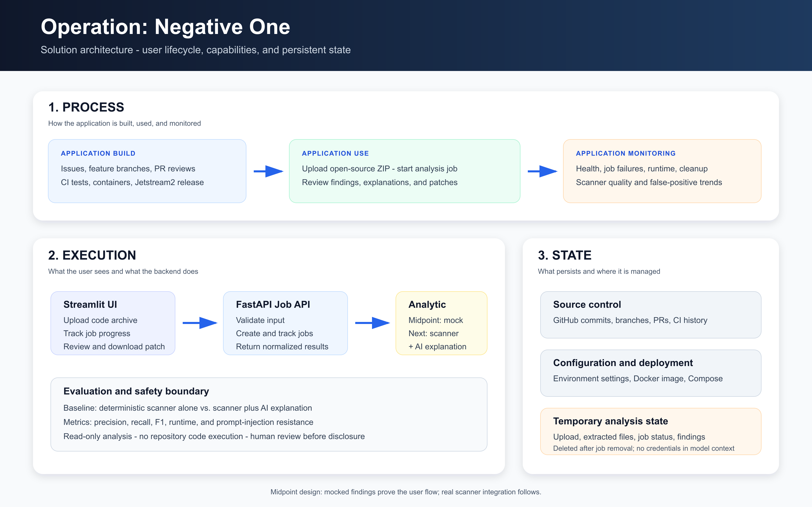

# Final Project Deliverable II — Solution Architecture

This directory contains architecture material for the DSAN 6700 Final Project
Deliverable II midpoint check-in.

## Solution architecture

The solution architecture presents the project at a high level through three
views:

- **Process:** build the application, use it to analyze submitted source code,
  and monitor its operation.
- **Execution:** move a submission through the user interface, job API, security
  analysis, and reporting workflow.
- **State:** keep source control and deployment configuration persistent while
  treating uploaded code, job status, findings, and proposed patches as
  temporary analysis state.

## Midpoint status

The diagram combines the working application foundation with the intended
security-analysis workflow. The repository currently contains a FastAPI
foundation, environment-based configuration, automated tests, Docker Compose
deployment files, and a Streamlit prototype with a mock job workflow on the
`streamlit-ui` branch. The real hunter, verification, patching, and reporting
pipeline remains planned work and is not represented as a completed analytic.

The team's separate technical architecture diagram will document the proposed
Jetstream2, sandbox, Qwen hunter, verifier, and patch-model implementation in
greater detail.
