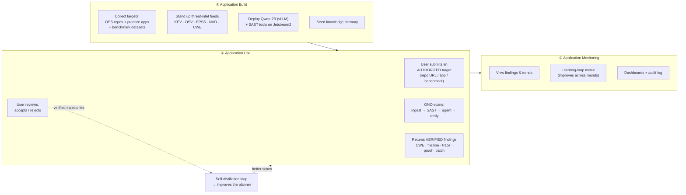
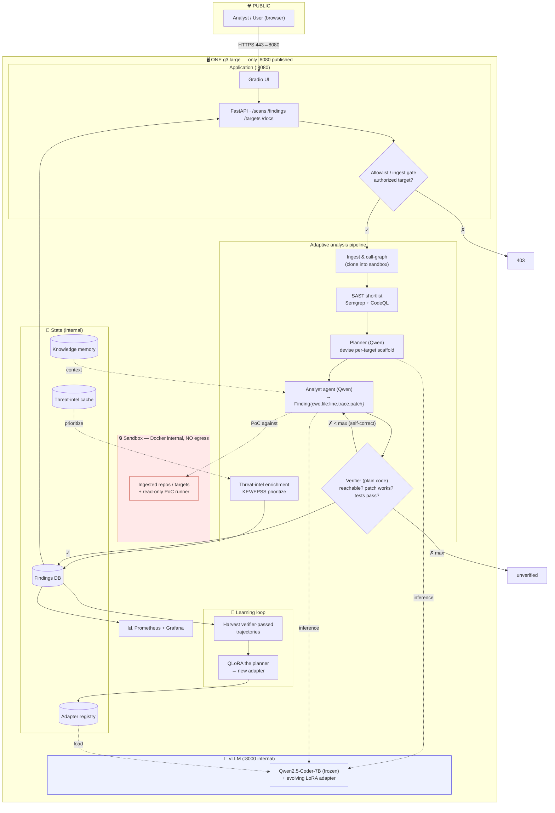

# Operation: Negative One — Final Project, Deliverable 2 (Midpoint Check-in)

**Team:** Sazan Khalid · Kenedy Ducheine · Junyi Tang · Jeffrey Pinarchick
**Course:** DSAN 6700 — Deploying Machine Learning Applications to Customers

- **Live application (Jetstream2):** `http://<INSTANCE-FLOATING-IP>:8080`  ← *fill in after deploy*
- **GitHub repository:** `https://github.com/dt7860920/6700-team-project` (prototype under `final-project/`)

> This submission includes the two required diagrams (solution architecture and technical architecture) and documents the deployed prototype. Mocking is used where noted; the full analytic is under active build.

---

## 1. Problem & goals

**Problem.** Finding exploitable security vulnerabilities in real software is slow and expert-bound. Static scanners are fast but bury teams in false positives; general LLMs hallucinate, can't localize a bug, and can't prove it's real.

**What ONO does.** ONO ingests an **authorized** codebase — primarily **open-source GitHub repositories** — finds the real vulnerabilities, **proves each one is reachable**, and proposes a **fix it has verified works**. It checks its own work (a deterministic verifier) before showing anything, and it **learns across scans** (a Fugu-inspired self-distillation loop) so it gets better over time.

**Target users:** security teams wanting a *proven* triage starting point; developers hardening their own code; maintainers of open-source projects.

**Goals (three tiers):**
- *Certain:* ingest a repo → return a finding with CWE, `file:line`, trace, and a suggested patch, served through a deployed API + UI on Jetstream2.
- *Likely:* **verified** findings (patch applies, exploit no longer fires, tests pass) + threat-intel prioritization (KEV/EPSS) + the self-distillation learning loop improving a metric across rounds.
- *Stretch:* real-world-code ingest at scale, detection-rule bundles, broader language coverage.

---

## 2. Solution architecture (Process · Execution · State)

The solution architecture specifies **what** problem is solved and how user needs are met, across three entities.

### Process — the use lifecycle



### Execution — how it functions (frontend + backend)

| Layer | What it does |
|---|---|
| **Frontend** (Gradio) | Submit an authorized target; see findings as cards with the output-strength **rung**, CWE, `file:line`, source→sink trace, proof-of-reachability, proposed patch, confidence; accept/reject. |
| **API (exposed)** | `/health`, `/info`, `/targets` (the allowlist), `/scans` (start + poll), `/findings`, `/docs` (OpenAPI). |
| **Backend (not exposed)** | Ingest + call-graph parse → SAST shortlist → **adaptive planner (Qwen)** → **analyst agent** → **deterministic verifier** (self-correction loop) → **threat-intel enrichment** (KEV/EPSS prioritize) → **learning loop** (harvest verified trajectories → QLoRA the planner). |
| **Core analytic** | A frozen **Qwen2.5-Coder-7B** wrapped in an adaptive harness + verifier, with a self-distillation learning loop. Built on open-source tooling; no frontier models. |
| **Baseline & performance** | Compared to *SAST-alone* and *stock-Qwen-no-scaffold* on execution-verified benchmarks; report precision/recall/FP **and the learning-loop improvement curve**. |

### State — what persists, and where

| Artifact | Where | Notes |
|---|---|---|
| Source code | GitHub repo | branches via env (dev/stage/prod); PR workflow + CI gates |
| Findings | Database (internal) | scan results, verdicts, rungs |
| Ingested repo snapshots | egress-blocked sandbox | copies we host; never the origin |
| **Threat-intel cache** | DB/volume | KEV/OSV/EPSS/NVD/CWE, refreshed daily |
| **Knowledge memory** | DB/vector store | confirmed patterns, per-repo threat context (evolves) |
| **Models & config** | Jetstream volume | Qwen-7B weights + the **evolving LoRA adapter** (versioned per learning round); config via settings/`.env`; secrets never in repo |
| Temporary/cached | in-memory | scan sessions, candidate queues, KV cache |

---

## 3. Technical architecture

Specifies **how** the components interact — technology, data flow, deployment. Everything runs on **one Jetstream2 g3.large**; **only the app port (8080) is published**.



**Reading it:** green = the only internet-facing surface. The request flows through the **allowlist/ingest gate** into the adaptive pipeline; the **verifier loop** (`Agent → Verifier → back to Agent`) is the self-correction cycle; the **learning loop** harvests verified trajectories and QLoRA-trains a new adapter that re-loads into the frozen model. The model, sandbox, DB, and intel cache are **internal only**.

- **Frontend:** Gradio, served by the API (one app, one port).
- **API layer:** FastAPI (documented via OpenAPI at `/docs`).
- **Model service:** vLLM serving Qwen-7B in-process on the box (internal).
- **Storage:** findings DB + threat-intel cache + knowledge memory + adapter registry (all internal — **DB port not published**).
- **Deployment:** Docker + Compose on Jetstream2; `docker compose up -d` is the whole start procedure.

---

## 4. The prototype (what's deployed for this check-in)

Per the rubric, this is a **skeleton** demonstrating the basic user flow; mocking is used where the full analytic isn't wired yet.

- **Flow a user can do now:** open the UI → submit an authorized target → receive a findings response (CWE, location, trace, suggested patch). *(Analyzer returns representative/mocked findings where the real pipeline isn't connected; the API, config, container, and UI are real.)*
- **Course concepts demonstrated:** configuration through settings (`model_backend`, allowlist), containerized deployment (Docker + Compose), a documented API (OpenAPI `/docs`), deployed on Jetstream2 with **only the app port published**.
- **How to run (fresh clone):**
  ```bash
  git clone <REPO-URL> && cd operation-negative-one
  cp .env.example.production .env
  docker compose up -d
  curl http://localhost:8080/health
  ```

---
