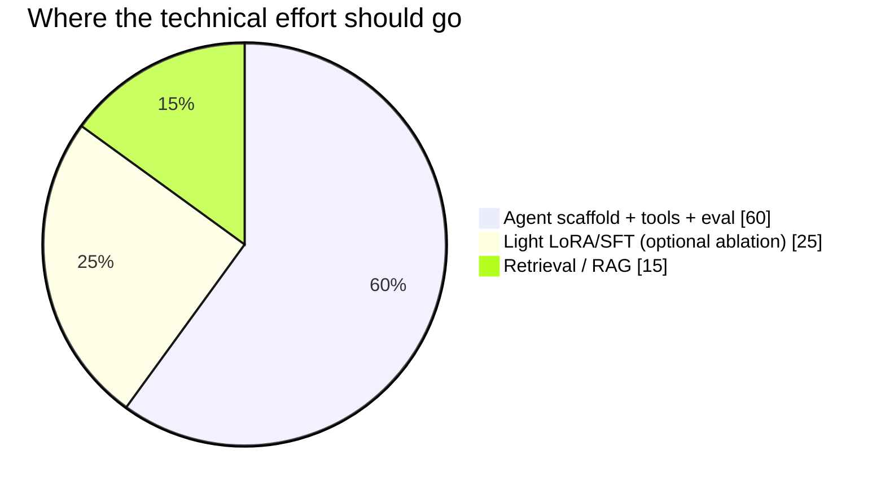
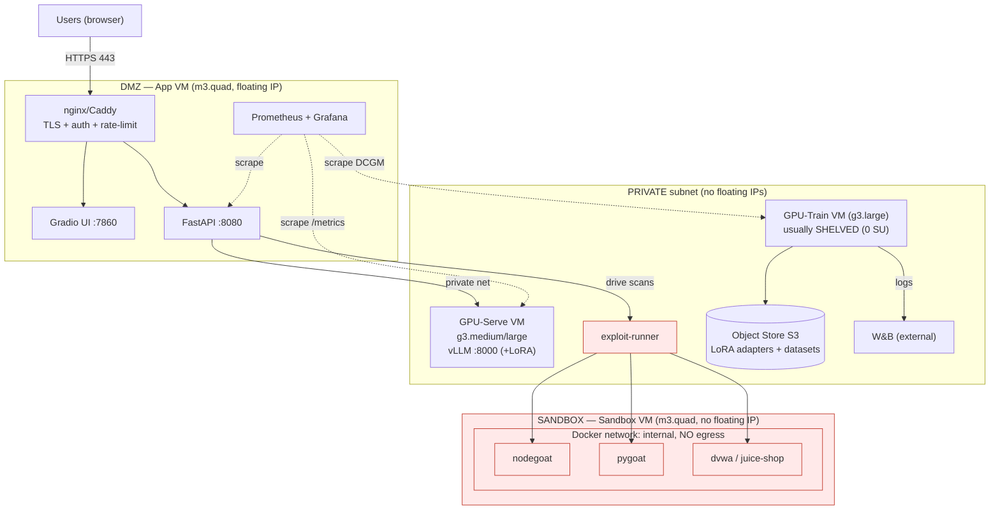
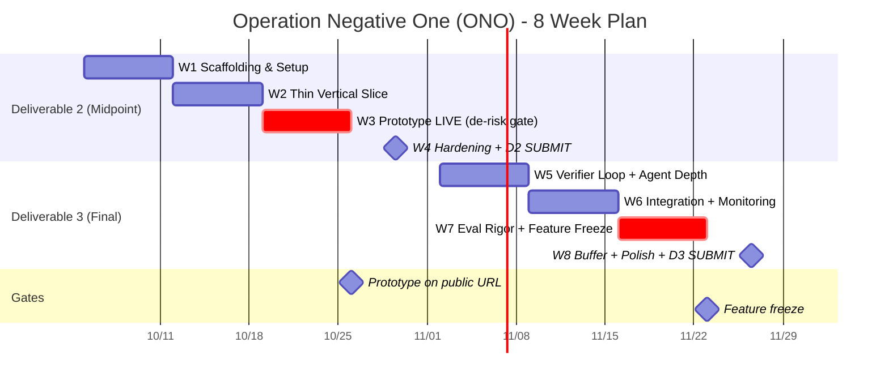
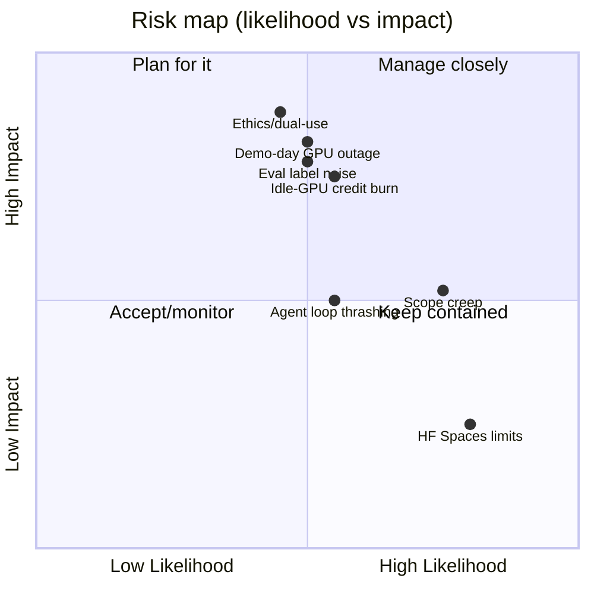

# Operation: Negative One (ONO) — Project Plan & Research Dossier

**Course:** DSAN 6700 — Deploying Machine Learning Applications to Customers
**Deployment target:** Jetstream2 (ACCESS-CI)
**Planning date:** 2026-10-05 · **Build window:** 8 weeks

> **What this document is.** A strengthened, research-grounded plan for ONO — an *agentic LLM system that finds software vulnerabilities, proves they are real, and proposes verified fixes*. It consolidates four parallel research passes (ML core, evaluation/data, infrastructure/MLOps, and risk/ethics) plus a review of two shipping security-agent systems (NVIDIA Nemotron; Hugging Face multi-harness RL), and lays out what to build, when, on what compute, under what guardrails.

---

## 0. TL;DR — what matters most

1. **Reframe the product from "scan any website" to "analyze an authorized target."** The tool runs only against **self-hosted vulnerable apps** (NodeGoat, PyGoat, DVWA, Juice Shop) and **benchmark sandboxes** — never live third-party sites. This is both the compliance fix for Jetstream2 *and* what makes the project defensible to a grader. This is the single most important change.
2. **Output strength is the headline.** ONO doesn't just flag bugs — it **proves each one is real** (reachable, demonstrated in the sandbox) and **proves its fix works** (patch applied, exploit no longer fires, tests still pass). This is "Rung 4" on the output ladder in §1, and it beats most commercial tools.
3. **The scaffold beats the model.** The *same model weights* score wildly differently depending on the harness around them (one measured study: 23% vs 52% on the same benchmark). So put ~60% of effort into the agent scaffold + tools + evaluation, ~25% into a light LoRA, ~15% into retrieval.
4. **"Learning" lives in the agent loop, not the weights.** A **verifier-in-the-loop self-correction cycle** steers the agent's next step from deterministic feedback, with the **model frozen**. No weight-updating RL (too heavy for 8 weeks); plain LoRA/SFT only, and even that is optional.
5. **Swap the base model** from Qwen3-4B to **Qwen2.5-Coder-7B-Instruct** (code-pretrained, best-evidenced 7B for this task, Apache-2.0). Keep Qwen3-4B as the constrained-GPU fallback.
6. **Restrict the MVP to Python + JavaScript** targets. PHP/C++ are stretch goals.
7. **Evaluate on execution-verified, repo-level, pairwise tasks** as the headline — not function-level binary F1.
8. **Get a live prototype on a public URL by Week 3** — a week before the midpoint — so Deliverable 2 is a polish pass, not a scramble.
9. **Jetstream2 fits easily in one Explore allocation** (~31k–45k SU of the 400k ceiling). The real cost risks are idle GPUs and demo-day GPU unavailability — mitigated by *shelving* and serving on a default-available flavor.
10. **Treat ethics/dual-use as a graded, documented deliverable**, not an afterthought.

---

## 1. The problem & the product

**Problem.** Finding exploitable vulnerabilities in code is slow, expensive, and expert-bound. Static scanners drown teams in false positives; frontier LLMs hallucinate and can't localize.

**Product.** ONO ingests a code target it is authorized to inspect, runs a hybrid *static-analysis + LLM-agent* pipeline, and returns verified findings — each with its CWE class, sink location (`file:line`), source→sink trace, a demonstration that the flaw is reachable, and a patch proven to close it.

### The output-strength ladder

How "strong" a finding is depends on how much it proves. This ladder is the spine of the product and of the goal tiers (§11):

| Rung | Output | Strength |
|---|---|---|
| **1** | "Line X looks vulnerable" (bare flag) | Weak — what a dumb scanner gives; many false alarms |
| **2** | Finding + CWE + a suggested patch | Decent — better than a scanner |
| **3** | …+ **proof it's real** (read-only PoC showing attacker input *reaches* the sink, demonstrated in the sandbox) | Strong — kills the "false positive" dismissal |
| **4** | …+ **proof the fix works** (patch applies, PoC no longer fires, tests still pass) | **Very strong — our target.** A finding a developer can merge with confidence |
| **5** | …+ a **detection rule** to catch exploitation until the patch ships (bridges code-fix and runtime defense) | Signature stretch — defense-in-depth; almost no student project does this |

**ONO targets Rung 4 as the deliverable floor**, with **Rung 5 (the patch+detection bundle) as the signature stretch and presentation headline.**

**Users:** (a) security teams wanting a triaged, *proven* starting point, (b) developers hardening their own code pre-release, (c) training/benchmarking for junior analysts.

**Hard scope boundary:** authorized, self-hosted targets only (see §10).

---

## 1.5 Locked build decisions & the adaptive (Fugu-inspired) harness

*Locked 2026-10-15. These take precedence over the more exploratory framing in §5-§7 and §11 where they differ.*

**Decisions:**
1. **Build the real system + harness** (not just the Deliverable-2 mock).
2. **One model: Qwen2.5-Coder-7B, run frozen.** No weight-updating RL and **no distillation from a frontier teacher — we have no frontier access.** Fine-tuning is optional (see the learning harness below).
3. **One GPU instance: g3.large (20 GB vGPU).** Serve the model **AWQ-INT4 (~5-6 GB) via vLLM**, leaving headroom for KV cache plus the CPU-side harness + egress-blocked sandbox on the **same box** (16 vCPU / 60 GB). Shelve when idle.
4. **No frontier models anywhere** — not as workers, not as a distillation teacher, not as an eval baseline. Everything runs on the local Qwen. This removes the eval's frontier baseline and takes eval cost to **~$0**.
5. **Build with AI coding tools.**

**What "no frontier" means:** it makes the "scaffold beats model, ship frozen" path (§0, §12) the definitive one. All effort goes into the **scaffold + verifier**, none into chasing model quality through training we cannot afford.

### The adaptive harness — inspiration: Sakana Fugu ([2606.21228](https://arxiv.org/abs/2606.21228))

Fugu's core idea — a model that **adaptively devises an agentic scaffold per request** instead of running a fixed pipeline — is our design north star. We **cannot copy Fugu directly** (it orchestrates *frontier* workers and *trains* a learned orchestrator via GRPO/evolution; we have neither). We take the **principle**, in a frontier-free, training-free form:

| Fugu mechanism | Our frontier-free adaptation |
|---|---|
| Learned orchestrator devises a per-query scaffold | **Frozen Qwen as a *planner*** — prompted to emit a structured per-target plan (`[ANALYZE sast lines] [CHECK taint source->sink] [VERIFY patch]`) that the harness executes step by step. Adaptive, no training. |
| Orchestrator vs. frontier workers | **Orchestrator vs. worker = two *roles* of the same frozen Qwen** (planner vs. bounded analyst) — echoes the NVIDIA split. One model, two prompts. |
| RL reward (sparse success + dense partial credit) | **The deterministic verifier is the reward-equivalent**, used at *inference* to steer the bounded self-correction loop (§3) — not to train. PoC-fires / patch-works / tests-pass = the signal. |
| Two-stage training (SFT on performance, then RL) | **Optional stretch -- the "learning harness":** self-distill by keeping only *verifier-passed* trajectories and QLoRA-ing the planner on them (a frontier-free echo of Fugu's Stage-1 SFT). Full orchestrator RL is out of scope. |

**Net:** the MVP harness is **adaptive (plans per target) but not learned**; the learned version (self-distillation on verified trajectories) is a named **stretch**, not the deliverable. Everything stays on one frozen Qwen + one g3.large, frontier-free.

---

## 2. What changed: weaknesses found → fixes applied

The research and the two shipping-system reviews surfaced plan-altering issues. These are the "strengthening" edits.

| # | Weakness in the original proposal | Fix in this plan |
|---|---|---|
| W1 | "Given a website → find its zero-days" (named real companies) | **Authorized-targets-only**; agent receives a `target_id`, never a URL/host; enforced by an allowlist + network isolation (§7, §10) |
| W2 | Output was just "find + fix" | **Output-strength ladder (§1)**: prove-it's-real + prove-the-fix-works (Rung 4), detection-bundle stretch (Rung 5) |
| W3 | Fine-tuning framed as the main lever | Fine-tuning is a **light, optional ablation**; effort shifts to scaffold + tools + eval. Evidence: same weights score 23%→52% across harnesses (§3, §6) |
| W4 | Qwen3-4B base, no code specialization | **Qwen2.5-Coder-7B-Instruct** primary; Qwen3-4B fallback (§5) |
| W5 | Binary "vulnerable/not" classification on noisy C/C++ datasets | Repo-level, **execution-verified, pairwise** evaluation; drop Big-Vul/Devign from the test set (§6) |
| W6 | Two cited benchmarks mis-categorized; two are exploit-dev (wrong task) | Verified every benchmark; use **ARVO / PrimeVul / VulnGym / PatchEval-230 / CWE-Bench-Java**; cite ExploitGym/ExploitBench as related work only (§6) |
| W7 | No deterministic verifier → false positives & unfaithful reasoning | **Deterministic verifier** that both gates findings *and* drives a bounded self-correction loop (§3) |
| W8 | Build orchestration from scratch | **LangGraph** typed state machine, one bounded ReAct loop (§3, §5) |
| W9 | "RAG over similar CVEs" — leakage hazard, wrong target | Retrieve **CWE knowledge + repo code (call graph)**, not CVE text (§3) |
| W10 | Idle-GPU credit burn & demo-day GPU unavailability | **Shelve** idle GPUs (0 SU); serve on default-available `g3.medium`; recorded-demo fallback (§7) |

### Effort allocation (the core strategic bet)



---

## 3. System architecture (ML pipeline)

A left-to-right pipeline with **one bounded agentic loop** and a **deterministic verifier** that does double duty. Static analysis finds candidates; the agent reasons over call-graph context to confirm/localize/fix; the verifier both gates every output *and* feeds failures back so the agent self-corrects — with the model frozen the whole time.

```mermaid
flowchart LR
    TR["Target Registry<br/>(id → repo snapshot,<br/>compose, labels)"] --> IN
    subgraph INGEST["1. Ingest & Index"]
        IN["Clone snapshot<br/>(no .git, strip CVE strings)"] --> PARSE["tree-sitter parse<br/>Jedi call graph (Py)<br/>entry-point enum (Flask/Express)"]
        PARSE --> CS[("Code Store<br/>Postgres + pgvector")]
    end
    CS --> SAST
    subgraph CAND["2. Candidate generation (SAST)"]
        SAST["SAST fan-out<br/>Semgrep + CodeQL → SARIF"] --> NORM["Normalize →<br/>Candidate{file,line,cwe_hint}"]
        NORM --> QUEUE["Candidate Queue<br/>(SAST ∪ entry-points, deduped)"]
    end
    QUEUE --> CTX["Context Builder<br/>k source→sink paths +<br/>callee bodies + CWE knowledge"]
    KN["Knowledge Index<br/>CWE XML · OWASP ·<br/>Semgrep rule msgs"] --> CTX
    CTX --> AGENT
    subgraph LOOP["3. Analyst Agent (LangGraph ReAct, frozen model)"]
        AGENT["Reason over code + tools<br/>tools: read_file, callers/callees,<br/>grep, retrieve_cwe, http_probe*"] --> FIND["Finding{cwe, sink file:line,<br/>trace, confidence, patch_diff}"]
    end
    VLLM["vLLM serve<br/>Qwen2.5-Coder-7B (+optional LoRA)"] -. backs .-> AGENT
    FIND --> VERIFY
    subgraph VER["4. Deterministic Verifier (plain code, no LLM)"]
        VERIFY["line/symbol exists?<br/>PoC reaches sink? (prove real)<br/>patch applies?<br/>PoC no longer fires? tests pass?"] --> GATE{verified?}
    end
    GATE -->|yes| STORE[("Findings Store")]
    GATE -->|no, &lt; max tries| FB["Append failure reason<br/>to agent context"] -.self-correct.-> AGENT
    GATE -->|no, max tries| UNV["Mark 'unverified'<br/>(never shown as a finding)"]
    STORE --> API["5. FastAPI"] --> UI["Gradio analyst UI<br/>+ accept/reject feedback"]
    STORE --> EVAL["Eval Harness → W&B"]

    classDef sandbox fill:#ffe9e9,stroke:#c0392b;
    class AGENT,VLLM,VERIFY sandbox;
```



\* `http_probe` is restricted to the isolated target network only (§4, §7).

### The verifier-in-the-loop (the "learning on the agent's steps")

The verifier is **one component with two jobs**:

1. **Gate (proves it's real).** No finding is shown unless deterministic checks pass — line exists, the PoC actually reaches the sink, the patch applies, the PoC no longer fires after the patch, and the test suite still passes. This is what lifts output to **Rung 4** (§1).
2. **Feedback signal (self-correction).** On failure, the *specific* reason ("patch hunk mismatch at line 44"; "PoC still triggers after patch") is appended to the agent's context, and the agent revises — a **bounded** loop (3–5 attempts), then it gives up and marks the finding "unverified."

This is improvement **at the orchestration layer with the model frozen** — not weight-updating reinforcement learning. NVIDIA's shipping Nemotron system uses exactly this pattern ("failed checks return structured feedback … for correction"; "up to five repair attempts"). Keeping it **bounded** is essential — the failure mode is an agent that thrashes (see R9).

### Optional: split the agent into hunter + fixer

NVIDIA's lesson — *"a reasoning model orchestrates … a post-trained open model handles a bounded expert task"* — suggests splitting Station 3 into two bounded roles: a **hunter** (decides whether a candidate is a real, reachable bug) and a **fixer** (writes the patch). Cleaner separation of concerns; adopt only if the single-agent loop proves unwieldy.

**Why this shape:** published results (VulnLLM-R, CORRECT) show that **structured call-graph context + a CodeQL/Semgrep scaffold** is what lifts a 7B model past frontier models — not raw fine-tuning. The verifier directly attacks the dominant failure mode (confident false positives) and is the mechanism behind strong, *proven* output.

---

### Adaptive planning (Fugu-inspired)

In the MVP the pipeline order above is fixed. The Fugu-inspired upgrade (see §1.5) is to let the **frozen Qwen plan the scaffold per target** — emit a short structured plan of which tools to run, which regions to inspect, and how deep to go — which the harness then executes, feeding each result back. This is *adaptive* orchestration on one frozen model (no training); the *learned* version (self-distillation on verifier-passed trajectories) is a stretch goal (§11).

## 4. Deployment topology on Jetstream2

Four zones, defense-in-depth. GPU, serving, and sandbox VMs carry **no public IP**; the exploit runner sits on an **egress-blocked Docker network**.



**Isolation is the operator's responsibility** — Jetstream2 does not restrict outbound VM traffic. Two enforced layers:

- **Perimeter:** sandbox/GPU VMs launched with no floating IP; SSH restricted to an allowlisted CIDR on the App VM.
- **Container egress block** (Docker bypasses `ufw`, so this is required):
  ```bash
  docker network create --internal ono-sandbox        # no route out
  # belt-and-suspenders in the DOCKER-USER chain:
  iptables -I DOCKER-USER -s 172.30.0.0/16 ! -d 172.30.0.0/16 -j DROP
  iptables -I DOCKER-USER -s 172.30.0.0/16 -d 10.0.0.0/8 -j DROP   # block private-net hops too
  ```

The egress-blocked sandbox is also what makes **Rung 3/4 output possible**: the agent can safely *run* a read-only PoC to prove reachability because nothing can escape to the internet.

---

## 5. Tech stack decisions

| Component | Choice | Why |
|---|---|---|
| **Base LLM** | **Qwen2.5-Coder-7B-Instruct** (Apache-2.0) | Code-pretrained, 128K ctx, best-evidenced 7B for vuln detection; fits A100-40GB for train+serve |
| Fallback LLM | Qwen3-4B / 7B AWQ-INT4 | For a 20GB vGPU slice only |
| **Model improvement** | **Light QLoRA (Unsloth/PEFT), optional** — r=16, α=16–32, lr 2e-4, 1–3 epochs; **no weight-updating RL** | Scaffold matters more; keep training cheap or skip it. Improvement lives in the agent loop (§3), with the model frozen |
| **Agent-step learning** | **Verifier-in-the-loop self-correction** (bounded 3–5 retries) | "RL outside, on the steps" — frozen model, deterministic feedback; same pattern NVIDIA ships |
| **Serving** | **vLLM** (OpenAI-compatible, `--enable-lora`) | A/B base vs adapter with no redeploy; batching. Ollama for laptop dev only |
| **Orchestration** | **LangGraph** StateGraph, one bounded ReAct node, hard tool-call budget | Typed state + checkpoints; avoids weeks of plumbing and swarm complexity |
| **SAST** | Semgrep (CE rulesets) + CodeQL (free for academic research) | SARIF output; CodeQL gives call graphs |
| **Code nav** | tree-sitter + Jedi (Py); tree-sitter/CodeQL (JS) | Entry→sink paths, not whole-file dumps |
| **Retrieval** | CWE knowledge + repo call-graph; embeddings secondary (Qwen3-Embedding-0.6B / CodeRankEmbed) | Avoids CVE-text leakage |
| **Backend/UI** | FastAPI + Gradio (behind nginx auth; never `share=True`) | Course-standard, fast to demo |
| **Monitoring** | Prometheus + Grafana + W&B | vLLM `/metrics`, DCGM-exporter, FastAPI instrumentator |
| **Compute** | Jetstream2 g3.medium (serve) + g3.large (train, shelved) + 2× m3.quad | Default-available serving flavor de-risks demo day |

---

## 6. Evaluation & data plan

**Headline principle:** the main metric is **repository-level, execution-verified, and pairwise** (does the system flag the *vulnerable* snapshot but not the *patched* one, and does its fix actually neutralize the PoC?). This is the same signal that drives the output ladder — **a Rung-4 finding and a passing eval case are verified by identical machinery.** Function-level F1 is secondary and reported with PR-AUC, MCC, and VD-S because base rates are tiny.

### Benchmarks & datasets — verified, with roles

| Dataset | Role | Lang | License | Why |
|---|---|---|---|---|
| **ARVO** | Headline execution-verified **pairwise** oracle | C/C++ | BSD-2 | 6,100+ reproducible OSS-Fuzz vulns with `-vul`/`-fix` Docker images + crash input; zero PoC-writing cost |
| **PatchEval-230** | Execution-verified **fix** oracle (non-C) | Go/JS/Py | Apache-2.0 | `vul-run.sh`/`fix-run.sh`/`unit_test.sh` gate fixes; aligns with MVP languages |
| **VulnGym** | Repo-level **localization** (web/business-logic) | multi | CC-BY-4.0 | 184 advisories, entry-point GT, ±5-line tolerance (*human-audited, recall-only — add precision measurement*) |
| **CWE-Bench-Java** | Cheap repo-level set **with a CodeQL baseline** | Java | MIT | 120 CVEs; ready-made SAST baseline to beat |
| **PrimeVul** | Function-level **statistics** | C/C++ | MIT | Temporal split, 564 paired fns, defines VD-S & pairwise metrics; 86–92% label accuracy |
| **XBOW / CVE-Bench (UIUC web)** | Self-hostable **web** targets | web | source-available | Dockerized web challenges — match the NodeGoat/PyGoat theme |
| Juliet/SARD | Control / pipeline sanity only | C/C++/Java | CC0 | Synthetic ceiling — never headline |
| DiverseVul/MegaVul | **Training only** | C/C++ | CC-BY / GPL | ~35% label FP — unusable for the test set |
| ~~Big-Vul, Devign~~ | **Excluded from eval** | — | — | 46–54% label accuracy; cite as *why not* |

> ⚠️ **Open tension to resolve:** ARVO/PrimeVul are C/C++, but the MVP targets Python/JS web apps. Lead evaluation with **VulnGym + PatchEval + XBOW/CVE-Bench-web + self-hosted NodeGoat/PyGoat** (language-aligned); keep ARVO/PrimeVul as optional methodological rigor if time allows. See §12.

### Four-tier evaluation protocol

| Tier | Data | Oracle | Metrics |
|---|---|---|---|
| **A — Headline** | ARVO + PatchEval-230 subset (+ web targets) | Execution (sanitizer / run scripts) | Detection rate, localization (file/fn/±5 line), **fix success (Rung 4)**, **pairwise P-C**, FP/repo |
| **B — Statistics** | PrimeVul test + CleanVul | Labels | F1, **PR-AUC, MCC, VD-S@FPR≤0.5%**, per-CWE (n≥30) |
| **C — Localization** | VulnGym + CWE-Bench-Java | Human-audited | Recall (their evaluator) **+ precision adjudication**, Cohen's κ |
| **D — Controls** | Juliet (sanity) · **transplanted** set · **post-cutoff** slice | Synthetic / re-injected / OSV commit | Memorization gap = (B − D) reported explicitly |

**Baselines (four + two):** SAST-alone; untrained model *in the same scaffold*; prompted frontier model; majority/random; **+ SAST→LLM-filter** (the real industrial competitor); **+ GT-masked ablation** (detects spurious cues).

**Statistics:** paired designs; McNemar for binary success; paired bootstrap (10k, clustered by project) for CIs; Holm correction across baselines; 3 seeds for ONO. *Power reality check:* at n≈100 the detectable difference is ~13pp, not 5pp — combine tiers (~450 tasks) for the main comparison and state this up front.

**Leakage controls:** network isolation during eval; strip `.git`, CVE strings, CHANGELOGs; log every tool call and audit 20 trajectories.

### Data source licensing (safe to use)

✅ **CISA KEV** (CC0) · **NVD/CVE** (public domain) · **OSV / GitHub Advisory DB** (CC-BY-4.0, best for fresh slices) · **Project Zero repo** (Apache-2.0, for CWE weighting).
❌ **Avoid:** Zero-Day.cz (proprietary), ZDI/MSRC (metadata only), HackerOne (no redistribution grant), CTF writeups (not ground truth). **Release scripts + identifiers (commit/path/lines), never bundled code.**

---

## 7. Compute budget on Jetstream2

**Allocation:** file an **Explore** request (400,000 credits; ~1-page proposal, approval often ≤1 business day; a graduate student can be PI with an advisor letter). Exchange ~80k → Jetstream2 **GPU**, ~40k → **CPU**. Create ACCESS IDs on Day 1. Email `help@jetstream-cloud.org` to enable request-only `g3.large`.

| Node | Flavor | SU/h | Plan | SU (8 wk) |
|---|---|---|---|---|
| GPU-Train (ephemeral) | g3.large (20GB vGPU) | 32 | ~80 h active, **shelved otherwise** | ~2,560 |
| GPU-Serve (vLLM) | g3.medium (AWQ) → g3.large (bf16) | 16 → 32 | 150 h dev + always-on last 3 wk | ~10.5k–21k |
| App VM (nginx/API/UI/monitoring) | m3.quad | 4 | always-on | ~5,376 |
| Sandbox VM (targets + runner, no public IP) | m3.quad | 4 | always-on | ~5,376 |
| **Total (+30% padding)** | | | | **~31k–45k SU** |

Comfortably within one Explore award. **Cost rules:** *shelve* GPU VMs when idle (0 SU, vs 50% stopped); **never suspend GPU instances** (libvirt bug); autoshutdown cron; serve on **g3.medium** (default-available) so a g3.large/g3.xl capacity shortage can't sink demo day.

**Fallback:** a Hugging Face Space (Gradio UI + small/quantized model) as the **Week-4 prototype** and demo-day backup — UI + model only; the vulnerable-target sandbox stays on the isolated Jetstream2 VM.

---

## 8. Eight-week timeline

Spine: **thin vertical slice first** — a live end-to-end demo (stock model, one vuln class, verified output) on a public URL by **W3**, a week before the midpoint.



| Week | Theme | Key milestones |
|---|---|---|
| **W1** | Scaffolding & setup | Repo/CI live; sandbox targets up (egress-blocked); KEV/OSV data pulled; eval schema frozen; Jetstream2 access confirmed |
| **W2** | Thin vertical slice | End-to-end locally: code → SAST → agent → **verifier** → location + fix on **one** CWE (e.g. SQLi); FastAPI+Gradio skeleton; eval harness v0 on dev split |
| **W3** | **Prototype LIVE (de-risk gate)** | Deployed to HF Spaces (public URL); architecture diagrams final; baselines run on dev split; **metrics pre-registered** |
| **W4** | Midpoint hardening + **D2 due** | Polish demo + write-up + diagrams; submit |
| **W5** | Verifier loop + agent depth | Bounded self-correction loop; prove-real PoC (Rung 3) + prove-fix (Rung 4); optional light LoRA; expand eval set |
| **W6** | Integration + monitoring | Verified pipeline served via vLLM; Grafana/Prometheus + W&B dashboards; 2–3 CWE classes; begin Rung-5 detection-bundle spike |
| **W7** | Eval rigor + **feature freeze** | Full eval vs baselines; ablations; freeze; draft 3-page report + slides |
| **W8** | Buffer + polish + **D3 due** | Dress rehearsal; final report; software package; **recorded demo as fallback** |

---

## 8.5 Smoke tests & CI gates

Fast, binary "does the critical path work at all" checks — run on every push, before every demo, after every deploy. The model is pluggable (`model_backend = mock | local | service`), so **CI runs `mock`** (fast, GPU-free, deterministic) and the **instance runs `local`** (real Qwen) — same harness, two speeds.

**Golden-path heartbeat:** scan PyGoat for SQLi → scan reaches `done` → ≥1 finding with a real `file:line` + a non-empty patch. If green, the whole pipeline is alive.

| Layer | Smoke check | When |
|---|---|---|
| Config / boot | app imports; settings load; invalid `ENVIRONMENT` rejected | CI |
| API | `/health`→200; `/targets` returns allowlist; `POST /scans` (valid)→202 | CI |
| Model (vLLM) | vLLM `/health`; trivial prompt returns non-empty | instance |
| SAST | `semgrep --version`; flags ≥1 on a known-bad snippet | CI |
| Ingest / parse | parse a target → function/route table non-empty | CI |
| Analyzer E2E | the golden path (mock in CI, real on instance) | CI + instance |
| Verifier | good finding→verdict; bogus `file:line`→rejected | CI |
| Self-correction loop | terminates within max retries (no thrash) | CI |
| Eval harness | run 1 benchmark task → pass/fail + a metric | instance |
| Deploy | `docker compose up -d`→`healthy`; `/health` from outside | post-deploy |

**Security smoke tests (blocking — they protect the authorization story):**
1. **Allowlist:** an unknown `target_id` / URL → **403**, no scan starts.
2. **Egress blocked:** from inside a sandbox container, reaching an external host **must time out**.
3. **Port exposure:** from outside, only `:8080` responds — vLLM `:8000` and the DB port are **not** reachable.

Wrap as `make smoke-ci` (mock set, in GitHub Actions) and `make smoke-live` (real-model + security set, on the instance); `scripts/golden_path.py` is the heartbeat.

---

## 9. Risk register



| # | Risk | L | I | Mitigation |
|---|---|---|---|---|
| R1 | Model/scaffold shows no lift over baselines | M | H | Keep stock + rule baselines; success = *verified output + honest eval*, not SOTA; LoRA is optional |
| R2 | Scaffold complexity spirals | M | M | Start with a 2–3 step scratch loop; adopt LangGraph/hunter-fixer split only when it earns its keep; timebox |
| R3 | Jetstream2 SU burn / A100 contention | M | M | Shelve idle GPUs; QLoRA; checkpoint often; develop on small samples; budget SUs up front |
| R4 | Scope creep (esp. toward Rung 5 / red-blue / RL) | H | M | Three-tier goals are the contract; feature freeze end of W7; advanced ideas → Stretch only |
| R5 | HF Spaces free-tier limits (sleep, no GPU) | H | L | Space = thin UI calling Jetstream2-hosted model; wake before demos; recorded backup |
| R6 | Eval invalid from label noise | M | H | Use PrimeVul-quality labels + hand-verified gold set; report FP rate; caveat limits |
| R7 | **Ethics / dual-use exposure** | M | H | §10 guardrails; authorized-targets-only; read-only PoC; weights private; defensive framing |
| R8 | Live demo fails | M | H | Pre-recorded demo in W7; local fallback deployment; dress rehearsal in W8 |
| R9 | **Agent loop thrashing** (self-correction never converges, burns tokens) | M | M | **Hard-cap retries (3–5)**; "give up → mark unverified" is a first-class, respectable outcome; log attempts and cost |

---

## 10. Ethics & dual-use guardrails

ONO is offensive-security-*adjacent*, so responsible use is a **graded, documented** part of the deliverable. Posture: *a defensive tool that uses offensive techniques, constrained so it cannot be misused during the course.* Each guardrail is written into the repo as policy **and** the report.

1. **Authorized-targets-only (enforced, not aspirational).** Runs only against self-hosted intentionally-vulnerable apps (NodeGoat, PyGoat, DVWA, Juice Shop) and public benchmark datasets. Enforced by a config **allowlist** + the agent receiving a `target_id`, never a URL. **Never** live third-party systems.
2. **Read-only proof-of-concept.** The Rung-3 "prove it's real" step demonstrates reachability of a flaw — it does not weaponize, pivot, exfiltrate, or persist. "This input reaches this sink," not a working exploit chain.
3. **Sandboxed execution.** Targets run in isolated, resettable Docker containers on an egress-blocked network (§4); no exploit code runs outside the sandbox.
4. **Public-source data only.** CVE / CISA KEV / OSV / Project Zero. No scraped private disclosures, no undisclosed 0-days.
5. **Weights stay private during the course.** Any fine-tuned LoRA adapters shared only with the instructor; any later release gets a separate harm/benefit review.
6. **Defensive framing, documented.** Every finding ships with a fix (and, at Rung 5, a detection rule); the report states the intended use (help developers/teams find and fix their own code).
7. **Responsible-disclosure stance, documented.** Nothing to disclose externally (only self-controlled targets are tested), but the report documents what the disclosure process *would* be.

> This section is also the written answer to **Professor Adriaanse's request** to confirm the activity is reasonable on Jetstream2. A send-ready one-page memo can be generated from §7 and this section.

---

### Scaling to real-world code — dual-use guardrails

Expanding beyond intentionally-vulnerable practice apps to **real open-source projects or users' own code** (via the ingest model: clone a copy into the egress-blocked sandbox, never contact the origin again) makes ONO more useful *and* more abusable. If/when we scale there, these guardrails are **mandatory and documented**:

- **Authorized users only** — not an open public endpoint; access is gated, with a user attestation ("I am authorized to analyze this code").
- **Read-only proof-of-concept** — prove reachability, never weaponize, pivot, exfiltrate, or persist.
- **Weights and tooling kept private** during the course; any release gets a separate harm/benefit review.
- **Full audit log** — every ingested target and every scan is recorded.
- **Responsible disclosure** — if ONO finds a *real, undisclosed* vulnerability in real software, that triggers coordinated disclosure to the maintainer, **not publication**; the repo documents the disclosure process.

The boundary never moves: we analyze **copies we host**, never a live third-party system.

## 11. Goals in three tiers (the scope-creep contract)

Tiers map directly onto the output-strength ladder (§1).

**Certain (graded floor — Rung 2→3):**
- Working agentic prototype, live on a public URL, returning **vuln location + CWE + suggested fix** for ≥1 CWE class, on the self-hosted sandbox, under §10 guardrails.
- **Read-only PoC that proves the flaw is reachable (Rung 3)** for the demonstrated classes.
- Architecture diagrams, 3-page report, presentation, reproducible software submission.
- Honest evaluation on a hand-verified gold set with baseline comparison.

**Likely (strong effort allocated — Rung 4):**
- **Verified fixes (Rung 4):** patch applies, PoC no longer fires, tests still pass — driven by the verifier-in-the-loop self-correction cycle.
- Multi-step agent across 2–3 CWE classes; optional light LoRA showing measurable lift over the stock baseline.
- Monitoring dashboards (Grafana/Prometheus + W&B).

**Stretch (only if buffer allows — named but scoped so they don't sink the build):**
- **Rung 5 — patch + detection-rule bundle** (signature stretch; bridges code-fix and runtime defense). Demonstrate on a few classes, don't over-promise.
- Hunter/fixer agent split (§3).
- 5+ CWE classes; benchmark leaderboard-style eval; automated patch re-validation.
- Retrieval grounding findings in known exploited patterns (KEV).
- Polished self-serve UX; PHP/C++ targets.
- **Real-world-code ingest** (public repos / bring-your-own code) under the dual-use guardrails (§10) — static analysis + self-hosted dynamic copies only, authorized users, fully logged.

**Explicitly scoped OUT (name in the report as "where this goes next," do not build):**
- **Weight-updating / agentic RL** of the model (the HF multi-harness-RL approach) — too much infra for 8 weeks; the verifier-in-the-loop gives most of the benefit with none of the training cost.
- **Red/blue adversarial loop** (NVIDIA's coevolving attacker/defender) — compelling future work, out of scope now.

---

## 12. Open decisions

Genuine forks the research surfaced:

1. **Eval language alignment (§6).** Lead with web/Python/JS sets (VulnGym, PatchEval, XBOW/CVE-Bench-web) and treat C/C++ ARVO/PrimeVul as optional rigor? *(Recommended: yes — keeps eval aligned with the MVP targets.)*
2. **Single agent vs hunter/fixer split (§3).** Start single-agent with the verifier loop; split only if it gets unwieldy? *(Recommended: yes — single first.)*
3. **Train at all, or frozen-only? (§5).** Given "scaffold beats model," is the light LoRA worth it, or ship a frozen model + strong scaffold + verifier loop? *(Recommended: ship frozen first; add LoRA only as a measured ablation if time allows.)*
4. **Serving precision (§7).** g3.medium + AWQ-INT4 (cheaper, default-available, demo-safe) vs g3.large + bf16 (higher fidelity)? *(Recommended: AWQ on g3.medium for the always-on demo; bf16 on g3.large only for eval runs.)*

---

## 13. Key sources
**Harness inspiration:** [Sakana Fugu Technical Report (2606.21228)](https://arxiv.org/abs/2606.21228) — adaptive, learned per-request orchestration; we take the adaptive-scaffold principle in a frontier-free, frozen-model form (§1.5).

**Shipping security-agent systems reviewed:** [NVIDIA Nemotron adaptive agentic cybersecurity](https://developer.nvidia.com/blog/building-an-adaptive-agentic-cybersecurity-system-with-nvidia-nemotron/) (orchestrator/specialist split; deterministic validation + replay; bounded repair loop) · [HF multi-harness RL](https://huggingface.co/spaces/FineEnvs/multi-harness-rl) (harness > model: same weights 23%→52%; agentic RL vs SFT — scoped out)
**Evaluation & datasets:** [PrimeVul](https://arxiv.org/abs/2403.17218) · [ARVO](https://github.com/n132/ARVO) · [VulnGym](https://github.com/Tencent/VulnGym) · [PatchEval](https://github.com/bytedance/PatchEval) · [CWE-Bench-Java/IRIS](https://github.com/iris-sast/cwe-bench-java) · [CyberGym](https://github.com/sunblaze-ucb/cybergym) · [ill-posed function-level classification, ISSTA'25](https://arxiv.org/abs/2408.12986)
**ML core:** [VulnLLM-R](https://arxiv.org/html/2512.07533v1) · [CORRECT survey](https://arxiv.org/abs/2504.13474) · [Qwen2.5-Coder-7B-Instruct](https://huggingface.co/Qwen/Qwen2.5-Coder-7B-Instruct) · [Unsloth LoRA guide](https://unsloth.ai/docs/get-started/fine-tuning-llms-guide/lora-hyperparameters-guide) · [vLLM LoRA](https://docs.vllm.ai/en/latest/features/lora/) · [Anthropic: Building Effective Agents](https://www.anthropic.com/research/building-effective-agents)
**Infrastructure:** [Jetstream2 instance flavors](https://docs.jetstream-cloud.org/general/instance-flavors/) · [allocations/budgeting](https://docs.jetstream-cloud.org/alloc/budgeting/) · [classroom allocations](https://allocations.access-ci.org/classroom) · [GPU FAQ](https://docs.jetstream-cloud.org/faq/gpu/) · [firewalls & Docker egress](https://docs.jetstream-cloud.org/general/firewalls/) · [LLM serving tutorial](https://docs.jetstream-cloud.org/general/llm/)
**Compliance:** [ACCESS Acceptable Use Policy](https://access-ci.org/acceptable-use/) · [Jetstream2 policies](https://docs.jetstream-cloud.org/general/policies/)
**Data sources:** [CISA KEV](https://www.cisa.gov/sites/default/files/feeds/known_exploited_vulnerabilities.json) · [OSV.dev](https://google.github.io/osv.dev/data/) · [Project Zero 0days-in-the-wild](https://github.com/googleprojectzero/0days-in-the-wild)
**Targets:** [OWASP PyGoat](https://vwad.owasp.org/app/pygoat/) · [DVWA](https://vwad.owasp.org/app/damn-vulnerable-web-application-dvwa/) · [XBOW benchmarks](https://github.com/xbow-engineering/validation-benchmarks) · [CVE-Bench (UIUC web)](https://github.com/uiuc-kang-lab/cve-bench)

---

*Synthesized from four parallel research passes plus a review of two shipping security-agent systems. Items marked ⚠️ or in §12 are genuine open decisions, not settled facts — verify the load-bearing Jetstream2 numbers (current g3 SU rates, request-only status) via `help@jetstream-cloud.org` and the official SU estimator before filing the allocation.*
